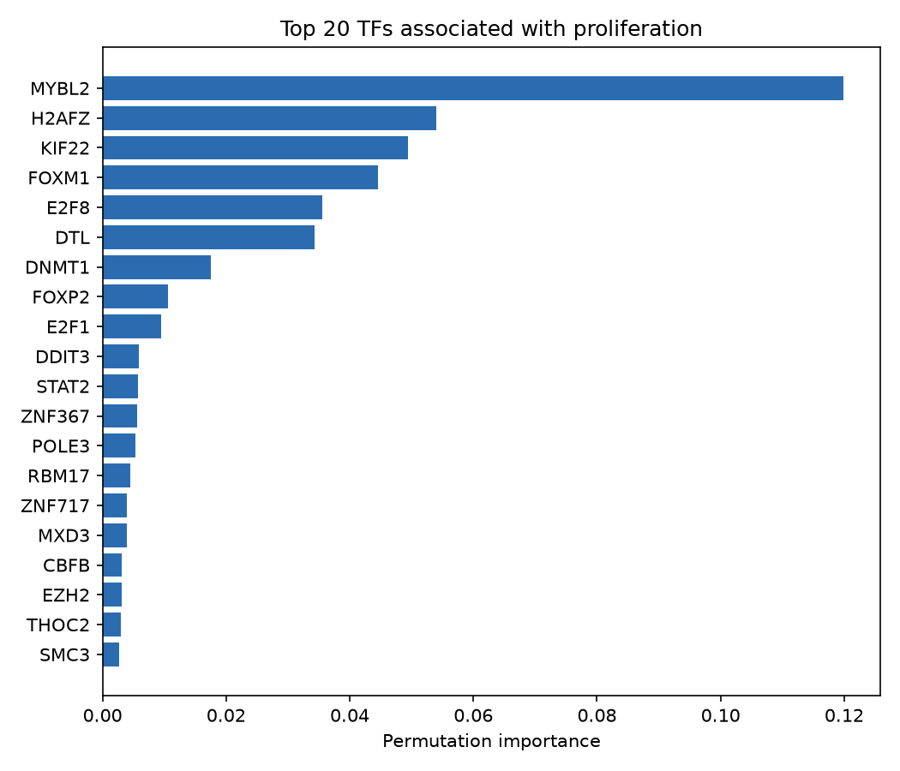

# Transcription factors and cancer-cell proliferation (NCI-60)

Which transcription factors (TFs) are most associated with cancer-cell proliferation?

I predict a **proliferation score** from **TF expression only**, using 57 cancer cell lines
from the NCI-60 panel, and rank the TFs by importance. Models: a **PyTorch** neural network
and a **Random Forest**, compared against Ridge regression and a mean-only baseline.

The full analysis is in [`tf_proliferation_analysis.ipynb`](tf_proliferation_analysis.ipynb).

## Method

| Step | What it does |
|------|--------------|
| Data | Log2 expression of 17,987 genes in 57 cell lines ([NCI-60 / CellMiner](https://github.com/Mathelab/NCI60_GeneMetabolite_Data)) and a list of human TFs ([pySCENIC](https://github.com/aertslab/pySCENIC)); 1,589 TFs are present in the data. |
| Target | Mean z-score of 28 cell-cycle marker genes (MKI67, PCNA, TOP2A, CCNB1...). |
| Features | Expression of the 1,589 TFs, with no overlap with the marker genes. |
| Feature selection | Top 50 TFs (`SelectKBest`), recomputed inside each CV fold to avoid data leakage. |
| Validation | 5-fold CV repeated 5 times; RMSE, MAE and R² (mean ± sd). |
| Ranking | Permutation importance from a Random Forest. |

## Results

| Model | RMSE | MAE | R² |
|-------|------|-----|----|
| Mean baseline | 0.669 ± 0.168 | 0.543 ± 0.128 | -0.124 ± 0.175 |
| Ridge | **0.229 ± 0.058** | **0.182 ± 0.048** | **0.844 ± 0.098** |
| PyTorch MLP | 0.267 ± 0.078 | 0.212 ± 0.063 | 0.789 ± 0.124 |
| Random Forest | 0.342 ± 0.110 | 0.254 ± 0.087 | 0.702 ± 0.107 |

- TF expression alone predicts proliferation well (R² between 0.70 and 0.84).
- With only 57 samples, the simple linear model (Ridge) does best.
- The top TFs include **MYBL2, FOXM1, E2F8 and E2F1**, all well-known cell-cycle regulators.
  The model recovers real biology, not noise.



## Run it

```bash
pip install -r requirements.txt
jupyter notebook tf_proliferation_analysis.ipynb
```

The notebook downloads the data into `data/` the first time it runs and writes the
outputs to `results/` (`metrics.json`, `tf_importance.csv`, `top_tfs.png`).

## Limitations

- Only 57 cell lines (inherent to NCI-60).
- The target is a transcriptomic proxy for proliferation, not a growth rate measured in the lab.
- Features and target come from the same expression platform.
- The importance ranking is descriptive (computed on the training data), and the TF list
  includes a few chromatin factors (e.g. H2AFZ) that are not classical TFs.

## References

- Reinhold et al. *CellMiner.* Cancer Res. 2012.
- Lambert et al. *The Human Transcription Factors.* Cell 2018.
- Aibar et al. *SCENIC.* Nat. Methods 2017.
